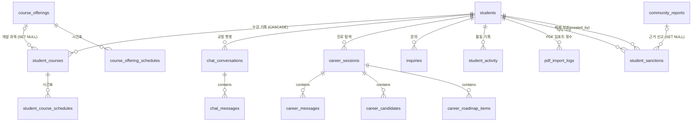
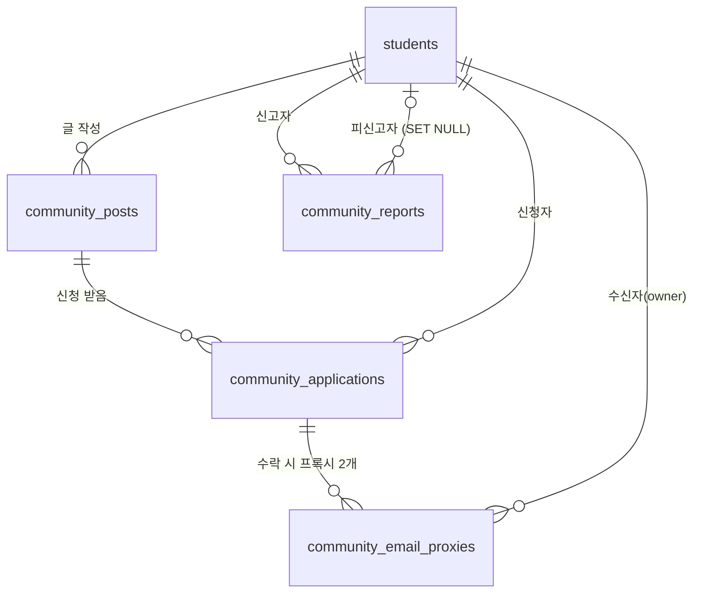
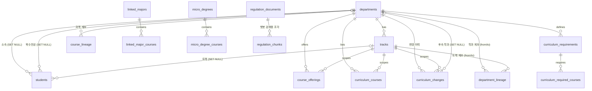
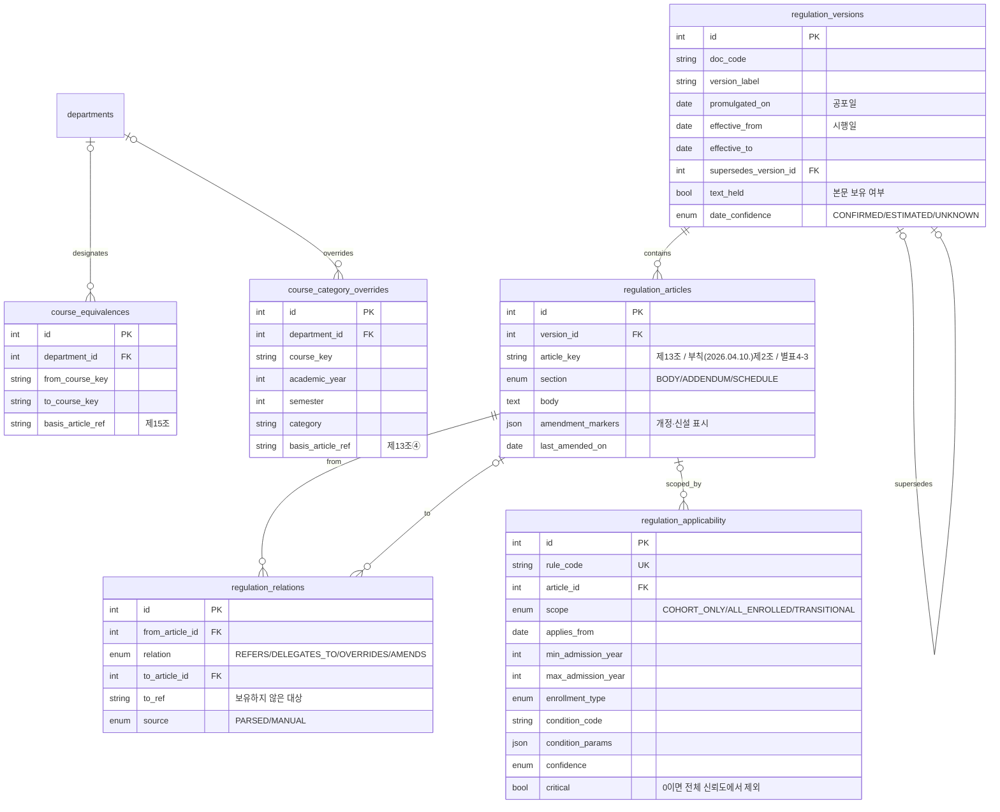

# wku-ai-chat Entity Relationship Diagram (ERD)

기준은 `db/schema.sql`이다. 이 문서는 **FOREIGN KEY로 선언된 관계만** 그린다(컬럼 목록은 `schema.sql`이 원본이라 여기엔 옮기지 않는다 — 손으로 옮긴 컬럼 목록이 가장 먼저 낡는다). 스키마에 테이블이나 FK를 추가하면 이 문서도 같이 고친다.

`students`를 중심으로 한 계정 쪽 관계와, `departments`를 중심으로 한 학과·교육과정 쪽 관계로 나눠 그렸다.

## 학생 계정 중심

## 커뮤니티

`community_email_proxies`는 신청 하나당 신청자·글쓴이 몫으로 정확히 2개여야 한다는 전제를 코드(`communityService.findEmailRelayTarget`)가 쓰지만, 이 전제를 DB 제약(UNIQUE)이 아니라 수락 트랜잭션(`acceptApplication`)이 지킨다.
`community_reports.target_id`는 글/신청을 가리키는 다형 참조라 FK가 없다(`target_type`으로 구분).

## 학과·교육과정 중심

FK로 이어지지 않는 독립 테이블: `sessions`(express-session 저장소), `email_login_tokens`(이메일 로그인 코드).
`linked_majors`, `micro_degrees`는 과목 테이블에만 연결되고 학과와는 FK가 없다.

## 규정 판단 엔진 (db/schema.sql 7.5절)

위 다이어그램들과 별개로, 아래는 규정 판단 엔진(`server/services/regulationEngine`)이 쓰는 테이블만 그린 것이다.
`regulation_documents`/`regulation_chunks`(챗봇 검색용, 재시딩 때 통째로 교체)와는 일부러 분리했다 — 이유는 `docs/regulation-engine/DECISIONS.md` D-24.

